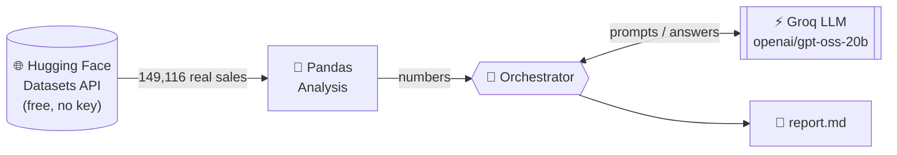
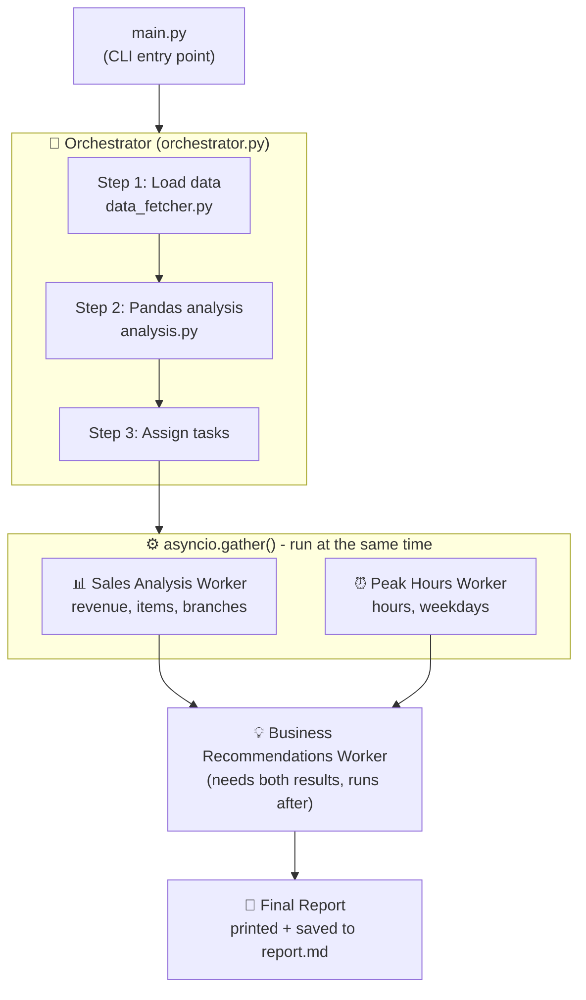
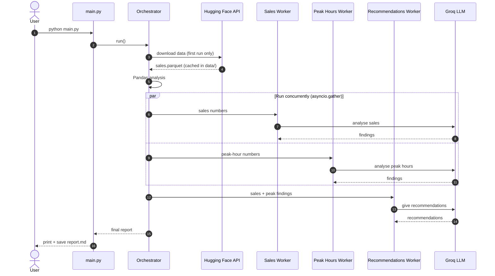
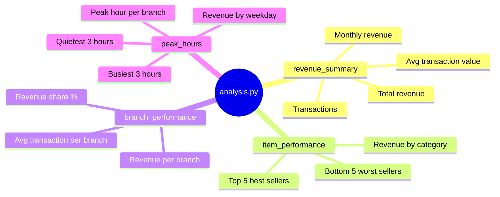
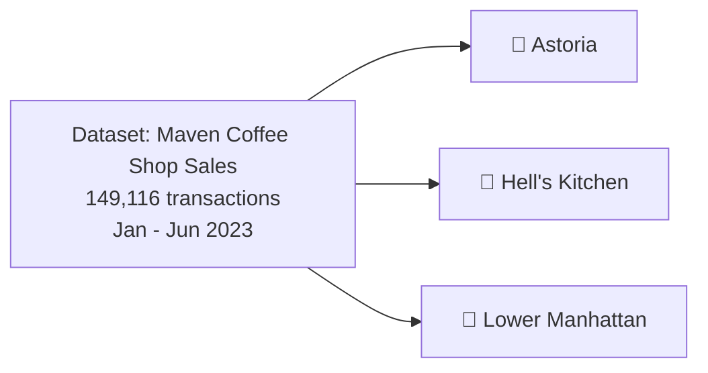
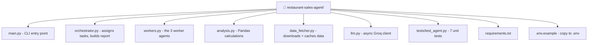
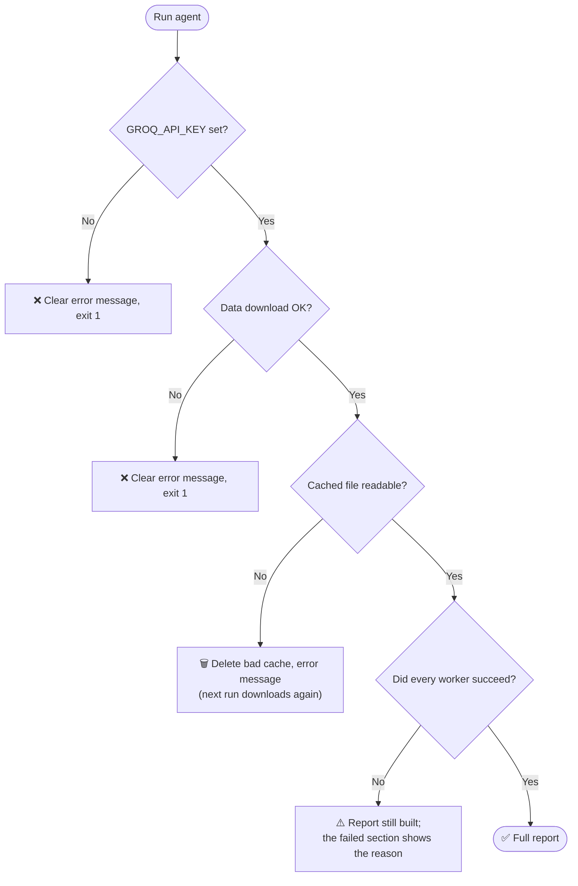
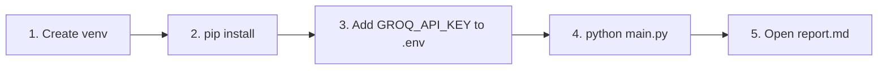

# AI Restaurant Sales Intelligence Agent

An Orchestrator/Worker AI agent that analyzes **real** restaurant sales data with Pandas
and writes a business report using Groq (`openai/gpt-oss-20b`).

## 1. Big Picture



## 2. Orchestrator / Worker Architecture



## 3. Step-by-Step Run (Sequence)



## 4. What the Pandas Analysis Calculates



## 5. Data Source



The dataset is [`jason1966/agungpambudi_trends-product-coffee-shop-sales-revenue-dataset`](https://huggingface.co/datasets/jason1966/agungpambudi_trends-product-coffee-shop-sales-revenue-dataset).
The first run downloads about 2 MB and caches it in `data/`. Run with `--refresh` to download it again.

## 6. Project Files



## 7. Error Handling



## 8. Setup and Run



```bash
cd restaurant-sales-agent
python3 -m venv .venv
source .venv/bin/activate          # Windows: .venv\Scripts\activate
pip install -r requirements.txt
cp .env.example .env               # then put your GROQ_API_KEY in .env

python main.py              # prints the report and saves report.md
python main.py --refresh    # downloads the data again
python -m pytest -q tests   # runs the tests
```

> If you already have the shared venv (`source /opt/turingiq-venv/bin/activate`), skip the
> venv and `pip install` steps. It already has every dependency.

## Notes

- In this dataset each row is one transaction line, so "average transaction" means the
  average value of one line.
- The LLM only gets the computed numbers. Its prompt tells it never to invent data.
